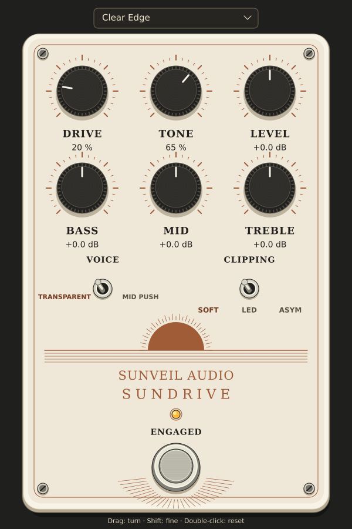

# Sundrive 1.3.2

> SOURCE REPOSITORY NOTE: This folder contains Sundrive 1.3.2 source and build inputs. Build with build_windows.bat; output is in Build/. Prebuilt VST3 bundles and Tools executables are excluded. The original release documentation below describes a prebuilt distribution. Install.bat and CheckPlugin.bat are release-packaging helpers; use the build instructions in the repository root README for this checkout.

A Sunveil Audio guitar overdrive: a transparent voice, a tighter mid-focused voice,
three clipping characters, and a three-band EQ. **Windows x64 · VST3 · Audio effect.**

Version 1.3.2 restores the original v1.3 stompbox design, with modest text readability changes: a portrait ivory enclosure,
copper sunrise artwork, six fluted knobs, miniature metal-style switches,
an amber status light, and a chrome footswitch. The editor is 600 × 900 at
100% scale and can be resized down to 75%. All controls are drawn live and
remain automatable; this is not a static image placed over the old editor.

The image is rendered from the same drawing commands as the Windows editor. It is
a design preview, not a screenshot from a Windows DAW.

## Install the ready-built plugin

1. Extract this ZIP first.
2. Copy the entire **Sundrive.vst3 folder** into
   `C:\Program Files\Common Files\VST3\`.
3. Open your 64-bit DAW or plugin host and rescan VST3 plugins.
4. Insert **Sundrive**, by **Sunveil Audio**, as an audio effect on your guitar track.

Keep the folder intact: the plugin binary is inside
`Sundrive.vst3\Contents\x86_64-win\Sundrive.vst3`.

Suggested chain: guitar DI → Sundrive → Helix Native or TH-U amp and cabinet →
your other effects. Start with **Clear Edge**, then compare **Mid Push**.

## Controls

| Control | What it does |
| --- | --- |
| Drive | Adds gain into the clipping stage, from a light edge to a saturated overdrive. |
| Tone | Darkens or brightens the driven sound. |
| Level | Output volume, −12 to +12 dB. Match the engaged and bypassed volumes by ear. |
| Bass | Low shelf at 120 Hz, −12 to +12 dB. |
| Mid | Bell EQ at 750 Hz, −12 to +12 dB. |
| Treble | High shelf at 3.2 kHz, −12 to +12 dB. |
| Transparent | Retains more low end and avoids the pre-drive mid boost. |
| Mid Push | Tightens the bass before clipping and pushes the mids. |
| Soft | Rounded, smoothly compressed clipping. |
| LED | More headroom with a firmer knee. |
| Asym | Uneven clipping for a different harmonic texture. |
| Footswitch | Engages or bypasses the pedal. |

These are original digital drive curves inspired by common overdrive behavior.
EQ comes after the drive and Tone stages. Watch your host output meter and
turn Level down if your following plugin clips.

## Presets and editing

The preset menu contains **Clear Edge**, **Mid Push**, **Glass Boost**,
**Indie Crunch**, **Tight Lead**, and **Warm Stack**. Loading a preset preserves
the current bypass state. Modified settings display as **Custom**. Save your
own sounds using your host's preset or project save function.

- Drag a knob vertically, or use the mouse wheel.
- Click Voice to toggle Transparent / Mid Push.
- Click Clipping to cycle Soft → LED → Asym → Soft. The selected label is copper.
- Hold **Shift** for finer adjustments.
- Double-click a knob, or press **Home** while it is selected, to reset it.
- **Tab** selects a control; arrow keys adjust the selection.
- **Space** toggles bypass. **P** opens the preset menu.
- Resize the editor to change its scale. Host-provided high DPI scaling is supported.

All nine controls are exposed for host automation, including Voice, Clipping,
and Bypass. A host such as Gig Performer can map its MIDI controls to these parameters.

## Audio and compatibility

- Mono, stereo, and mono-to-stereo operation.
- 32-bit and 64-bit floating-point processing.
- Sample rates from 22.05 to 384 kHz; 44.1, 48, and 96 kHz are normal choices.
- Fixed 4× oversampling and 5 samples of reported latency
  (about 0.10 ms at 48 kHz), reduced from 32 samples in v1.0.
- Smoothed controls and a crossfaded, latency-aligned bypass.
- No additional runtime DLLs are required beyond the Windows system libraries.

Since v1.1, the minimum-phase filters retain the previous anti-alias magnitude response
and reduce delay by moving energy earlier in time. Their phase response changes:
the measured low-frequency delay is 5 samples, and the identity-path impulse peak
is 6 samples. High-frequency group delay varies with frequency, so the 5-sample
host value is not a constant delay at every frequency. Attack and bypass
transitions can sound slightly different from v1.0. The Drive, Tone, EQ, clipping
curves, parameter IDs, and saved-state format remain compatible.

**Validation:** the current native audio/host tests passed 398,193 checks, and the
Windows x64 plugin and optional Windows test executable compiled successfully.
The DSP source is unchanged from v1.2. The previous v1.2 implementation passed
47 official Steinberg validator tests; that validator was not rerun for v1.3.
Windows DAW loading, native GUI interaction, and listening remain unverified.
See [VALIDATION.md](VALIDATION.md) for the precise scope.

You can run the included **CheckPlugin.bat** on Windows to exercise the plugin
without installing a compiler. It opens a brief test window and writes two editor
screenshots into the Tools folder. This is optional; you can also load the plugin
directly in your host.

The source, vendored VST3 interface headers, build instructions, and tests are
included. See [BUILDING.md](BUILDING.md) if you want to modify it.

To uninstall, remove the Sundrive.vst3 folder after closing your host.
